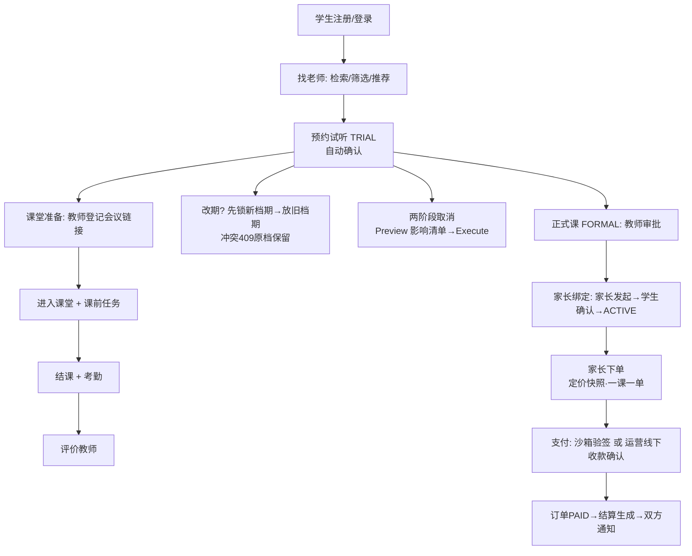
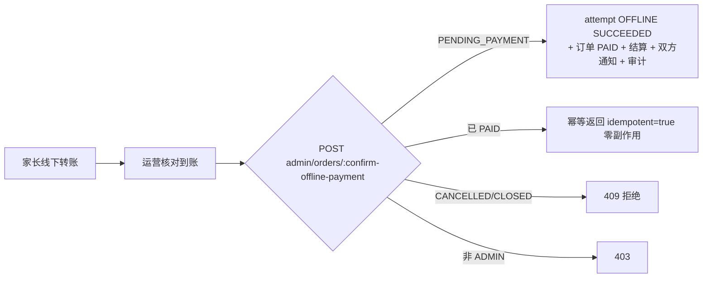
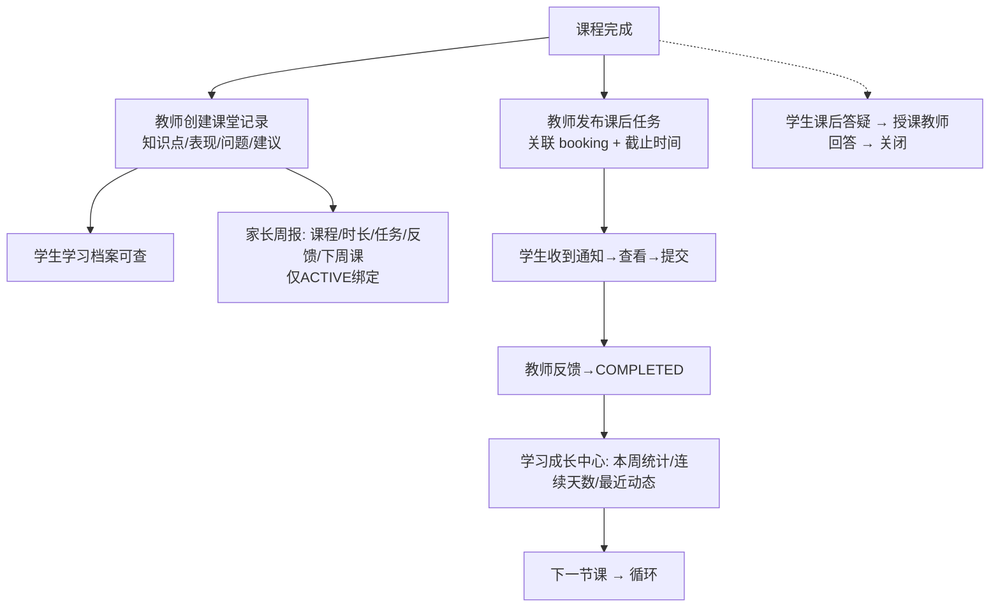

# PROJECT_FEATURES.md — NURTURE / 润物细无声 功能审计与说明

> 生成日期：2026-09-30 ｜ 审计方式：以实际代码为准（后端 17 模块端点逐一导出 + 前端路由/组件盘点 + 测试文件核对），辅以既有测试报告。
> 状态图例：**A** 已实现且有验证依据 · **B** 已实现但尚未充分验证 · **C** 部分实现 · **D** 仅有界面/演示 · **E** 依赖外部条件 · **F** 未实现或待确认
> 关联文档：`PROJECT_HANDOFF.md`（续作入口）· `docs/PROJECT_CONTEXT.md`（需求约束）· `docs/ARCHITECTURE.md`（架构）· `docs/CHANGELOG.md`(变更) · `../项目交接.md`（滚动事实源）

## 目录

1. [项目概览](#1-项目概览)
2. [功能总览](#2-功能总览)
3. [用户角色与权限](#3-用户角色与权限)
4. [全部功能模块详解](#4-全部功能模块详解)
5. [核心业务流程](#5-核心业务流程)
6. [模块之间的关联关系](#6-模块之间的关联关系)
7. [系统管理和辅助能力](#7-系统管理和辅助能力)
8. [外部服务与集成能力](#8-外部服务与集成能力)
9. [当前功能完成度](#9-当前功能完成度)
10. [已知问题和功能限制](#10-已知问题和功能限制)
11. [后续建议](#11-后续建议)
12. [代码定位索引](#12-代码定位索引)

---

## 1. 项目概览

| 项 | 内容 |
|---|---|
| 项目 | 润物细无声 / NURTURE — 线上家教与学习服务平台 |
| 定位 | 不止「找老师」：覆盖 找老师→预约→支付→课堂 的**交易闭环**，以及 课后任务→课堂记录→学习成长→家长周报→课后答疑 的**学习过程与成长陪伴层** |
| 服务对象 | 学生（学习者）、家长（付费与监督）、教师（个体执业者）、平台运营（治理），及 AI Agent（服务账号形态的扩展入口） |
| 技术栈 | Angular 19 + TypeScript ｜ Java 25 + Spring Boot ｜ PostgreSQL 17 + Flyway(V1–V10) + JPA/Hibernate ｜ Caffeine ｜ Spring Security ｜ Docker ｜ Cloudflare Pages/Tunnel |
| 架构 | 模块化单体，17 个业务模块（16 原有 + learning），每模块 api/app/domain/infra 四层；ArchUnit 强制「模块间禁触 infra、控制器零仓储」 |
| 开发阶段 | 代码与质量就绪，**Staging 部署门前**；生产部署/合规/支付渠道决策未完成 |

---

## 2. 功能总览

| 功能域 | 面向角色 | 核心能力 | 状态 |
|---|---|---|---|
| 身份认证 | 全部 | 注册（学生/家长/导师）、密码登录、短信登录、令牌刷新、登出、账号锁定/解锁 | **A** |
| 教师发现 | 学生/家长 | 多维检索、规则化推荐（可解释理由）、需求发布、教师收藏 | **B**（检索 A；收藏/推荐 B） |
| 资质认证 | 教师/运营 | 材料提交、审核状态流转、通过/驳回 | **A**（提交有界面） |
| 档期管理 | 教师 | 发布快捷时段、日历查看、删除（下架） | **A** |
| 预约与改期 | 学生/教师 | 试听自动确认、正式课审批、两阶段取消、原子改期 | **A** |
| 订单与支付 | 家长/运营 | 监护授权下单、定价快照、沙箱验签支付、运营线下收款确认 | **A**（沙箱/线下）/ **E**（真实渠道未接） |
| 课堂履约 | 教师/学生 | 会议链接登记、进入课堂、结课、考勤 | **A**（链接模式） |
| 退款仲裁 | 家长/运营 | 退款工单、两阶段仲裁（评估→执行） | **A** |
| 结算 | 教师 | 课酬流水（扣平台抽成）、待结算/已提现 | **A** |
| 站内消息 | 全部 | 会话私信、系统通知、已读标记 | **A** |
| 评价 | 学生→教师 | 课程完成后评价（星级/标签/评语）、已评价标记、教师档案展示 | **A**（2026-10-09 补前端提交入口） |
| 学习成长中心 | 学生 | 下一节课、今日任务、本周统计、连续天数、最近动态 | **B** |
| 课后任务 | 教师/学生 | 发布、提交、反馈，状态机与截止/逾期 | **B** |
| 课堂记录 | 教师/学生/家长 | 知识点/表现/问题/建议，进学习档案 | **B** |
| 学习档案 | 学生 | 目标/阶段/科目 + 统计 + 记录 + 教学历史 | **B** |
| 家长学习周报 | 家长 | ACTIVE 绑定孩子的周课程/时长/任务/反馈/下周课 | **A**（2026-10-09 补前端入口；含专属 IT 与 E2E） |
| 课后答疑 | 学生/教师 | 向授课教师结构化提问、回答、关闭 | **B** |
| 教师收藏/对比 | 学生 | 收藏 toggle、收藏列表；对比仅数据基础 | **B** / 对比 **F** |
| 规则化推荐 | 学生/家长 | 按科目/预算/风格/评分输出可解释理由 | **B** |
| 运营后台 | 运营 | 全景、审核、仲裁、账户管控、审计、平台配置、线下收款确认、登录限频解锁 | **A** |
| AI Agent 入口 | Agent | API Token（Scope+加盐哈希）、MCP 工具目录 | **A**（上层智能 🔵） |
| 健康检查 | 运维 | actuator health + liveness/readiness + compose 链 | **A** |
| 定时任务 | 系统 | 课程临近提醒（60s 扫描/30min 窗口/唯一去重）、Outbox 派发 | **A** |
| 正式音视频课堂、AI 智能批改/报告、公开问答社区 | — | — | **F**（规划，未实现） |

---

## 3. 用户角色与权限

### 3.1 角色能力矩阵

| 能力 | 学生 | 家长 | 教师 | 运营 | Agent |
|---|:-:|:-:|:-:|:-:|:-:|
| 检索教师/查看评价 | ✅ | ✅ | — | — | ✅(scope) |
| 发布学习需求 | ✅ | ✅ | ❌(403) | — | ❌(只读) |
| 收藏教师 | ✅ | — | — | — | — |
| 发布/管理档期 | — | — | ✅ | — | — |
| 预约试听 | ✅ | — | — | — | — |
| 审批正式课 | — | — | ✅ | — | — |
| 改期/取消 | ✅(双方) | — | ✅(双方) | — | — |
| 发起监护绑定 | — | ✅ | — | — | — |
| 确认绑定 | ✅ | — | — | — | — |
| 下单 | ✅(本人课) | ✅(已绑定孩子) | ❌ | — | — |
| 发起支付 | ✅(本人订单) | ✅(付款订单) | ❌ | — | — |
| 确认线下收款 | ❌(403) | ❌ | ❌ | ✅ | — |
| 发布课后任务 | — | — | ✅(自己课程) | ✅ | — |
| 提交任务 | ✅(本人) | — | — | — | — |
| 任务反馈 | — | — | ✅(归属任务) | — | — |
| 课堂记录 | 读(本人) | 读(周报) | ✅(自己课程) | — | — |
| 学习档案 | ✅(本人) | — | ✅(授课关系) | ✅ | — |
| 学习周报 | — | ✅(ACTIVE 绑定) | — | — | — |
| 课后答疑 | ✅(→授课教师) | — | ✅(→自己学生) | — | — |
| 资质审核 | — | — | — | ✅ | — |
| 退款仲裁 | — | 发起 | — | ✅ 两阶段 | — |
| 账户锁定/解锁 | — | — | — | ✅ | — |
| 审计日志 | — | — | — | ✅ | — |
| 平台配置 | — | — | — | ✅ | — |

### 3.2 权限执行方式（后端实校，非前端隐藏）

- 类/方法级 `@PreAuthorize`（`hasRole('X')` 或 `hasAuthority('SCOPE_x')`——Agent 兼容），见各 Controller。
- 对象级授权在 ApplicationService：订单仅付款方/参与双方/运营（`PaymentApplicationService.initiate`）；任务提交/反馈按 `studentId/teacherId` 归属比对；答疑按 `hasTeachingRelation`（历史预约）；周报按 `isActiveGuardian`；教师档案按授课关系。
- 探针回归：`tools/probe_authz.py` 19 项用例多轮 **0 漏洞**（最近一轮 18 项正确拒绝 + 1 项数据态跳过）。

---

## 4. 全部功能模块详解

> 路径基准：`backend/src/main/java/com/nurture/<模块>/`、`frontend/src/app/`。

### 4.1 身份认证与账户（identity）

**功能定位**：四类角色注册/登录/会话管理，以及 Agent 专用 API Token。
**适用角色**：全部。
**入口**：`/auth` 登录门户（角色 Tab + 密码/验证码切换 + 注册）；`/api/v1/identity/auth/**`、`/api/v1/identity/api-tokens`。
**具体能力**：三角色注册（教师含学校/学历/教龄）；密码登录；短信登录（验证码发送+试错作废）；刷新令牌（单次轮换+重用全吊销）；登出清 Cookie；Agent Token 签发/吊销（库中仅存加盐哈希+定位哈希唯一索引）。
**业务规则**：手机号格式校验、密码 ≥8 位、重复注册 409；登录连续错 5 次锁 15 分钟（IP 100 次防撞库）；短信三级限频（60s/时 5 条/日 10 条）；验证码错 5 次作废；登录失败话术统一防枚举。
**处理结果**：签发 HttpOnly Cookie（NURTURE_AT 30min / NURTURE_RT 14d）；注册自动建档案与引导；教师注册送「NUR-TEA-」编号。
**关联模块**：admin（锁定/解锁/限频重置）、messaging（通知）、audit。
**实现依据**：`identity/app/IdentityApplicationService.java`、`identity/app/SmsRateLimiter.java`、`BootstrapAdminRunner.java`；测试 `IdentityApplicationServiceTest`、`AccountLockoutIT`、`SmsCodeStoreLogSafetyTest`。
**当前状态**：**A**。
**已知限制**：短信通道本机收不到真实验证码（无服务商），验证码仅服务端内存存在且不落日志——手机端测试请用密码登录。

### 4.2 教师发现（matching）

**功能定位**：帮学生按条件找到合适教师，并沉淀需求与收藏。
**入口**：公开页 `/teachers`（米白主题）；学生端 `/student/match`（搜索+需求两路）。
**具体能力**：`GET matching/teachers:search`（科目/学段/价格上限/风格/关键词/含审核中，evidenceScore 证据序）；`teachers:recommend`（规则化理由推荐）；需求发布/列表/撤回；收藏 toggle 与收藏列表。
**业务规则**：搜索默认仅含「已审核通过 + 在售条目」；风格匹配按档案 teachingStyleTags；关键词匹配科目/学段/院校。
**关联模块**：teacher.app（在售条目）、verification（审核态）、review（评分）、scheduling（最近可约）、identity（姓名）。
**实现依据**：`matching/app/MatchingApplicationService.java`；`features/teachers/`、`features/match/`。
**当前状态**：检索 **A**（E2E）；收藏/推荐 **B**（新增，逻辑+唯一约束，专属用例待补）。
**已知限制**：推荐不含「周末档期」类时间理由（接口参数未暴露时间维度）；教师对比界面未实现（F）。

### 4.3 资质认证（verification）

**功能定位**：教师信任准入。
**入口**：教师提交材料（multipart，`/verification/cases`）；运营后台「教师资质审核流转」。
**业务规则**：SUBMITTED → UNDER_REVIEW/APPROVED/REJECTED；运营「通过/驳回」带 note；未通过审核不可被检索/接单。
**实现依据**：`verification/app/VerificationApplicationService.java`；admin `decideVerification`；E2E 第 3 节 + admin 后台实测。
**当前状态**：**A**（教师自助上传界面未见——见已知限制）。
**已知限制**：前端无「上传资质」页面，材料提交仅 API/测试通道；界面待补。

### 4.4 档期管理（scheduling）

**功能定位**：教师时间资产管理，是预约的前提。
**具体能力**：发布时段（快捷模板）、开放时段查询、教师日历、删除（业务语义为下架置 BLOCKED，非物理删）。
**业务规则**：同时段排他（含边界重叠 409）；预约后状态 OPEN→BOOKED；改期「先锁新再放旧」，失败原子回滚。
**实现依据**：`scheduling/app/SchedulingApplicationService.java`；`BookingRescheduleIT`。
**当前状态**：**A**。

### 4.5 预约与改期（booking）

**功能定位**：履约安排核心。
**具体能力**：创建预约（试听自动确认/正式课 REQUESTED）、教师审批（确认/驳回）、学生课程表、两阶段取消（Preview 出影响+10 分钟确认凭证 → Execute）、原子改期、开课/结课（归属教师限定）。
**业务规则**：同 slot 唯一活跃预约（部分唯一索引）；改期仅 CONFIRMED 且新旧不同；取消级联（释放档期/关订单/退钱包）；凭证过期需重取。
**实现依据**：`booking/app/BookingApplicationService.java`；`BookingRescheduleIT`（2）、`GuardianBindingOrderAuthIT`；E2E 预约/改期全链路。
**当前状态**：**A**。

### 4.6 订单与支付（order + payment）

**功能定位**：资金入口与状态机。
**具体能力**：家长/学生下单（金额取教师定价快照；一课一单 `ux_orders_booking`）；发起支付（幂等，重复 INITIATED 409）；MOCK 通道沙箱回调（HMAC 验签+防重放+金额一致）；**运营线下收款确认**（模式 B）；订单详情（付款方/参与双方/运营可见）。
**业务规则**：订单状态机 PENDING_PAYMENT→PAID→CLOSED / PENDING_PAYMENT→CANCELLED→CLOSED；支付成功联动=扣家庭钱包+生成结算+双方通知；确认线下收款幂等（重复返回同结果）。
**实现依据**：`order/app/OrderApplicationService.java`、`payment/app/PaymentApplicationService.java`；`OfflinePaymentStateMachineIT`(8)+`OfflinePaymentConcurrencyIT`(6 并发恰 1)；E2E 第 8/16 节。
**当前状态**：沙箱与模式 B **A**；真实渠道 **E**（`PaymentGateway` 端口就绪，等商户资质）；**运营确认收款界面 = A**（2026-10-09 补「订单与收款」卡 + `GET /admin/orders/pending-payment`）；**家长下单/支付操作界面仍缺**（API 完整，见 ROADMAP G7）。
**已知限制**：客户端伪造金额被忽略（服务端定价为准）；生产环境沙箱强制关闭。

### 4.7 课堂履约（classroom）

**功能定位**：上课环节的组织与留证（外部会议链接模式）。
**具体能力**：教师登记会议链接（每课一条）、学生获取入会信息、课前四任务（可跳过）、结课、考勤（PRESENT/LATE/ABSENT）。
**业务规则**：参与双方才可 join；无链接时提示「课堂尚未就绪」；结课后才能考勤。
**实现依据**：`classroom/app/ClassroomApplicationService.java`；E2E 课堂链路。
**当前状态**：**A**；「进入课堂」已实现（2026-10-09）：学生端订阅 join 响应，校验 http/https 协议后新窗口打开会议链接；无链接提示「课堂尚未就绪」，弹窗被拦截时降级为可点击链接。

### 4.8 退款仲裁（refund）

**具体能力**：家长/学生发起退款工单 → 运营「①评估影响」→「②执行退款」（带确认令牌，跳步拒绝）→ 原路退回家庭钱包。
**实现依据**：`refund/`、admin `arbitration:preview/execute`；E2E 覆盖。
**当前状态**：**A**。

### 4.9 结算（settlement）

**具体能力**：支付成功自动生成课酬条目（gross − 平台抽成 15% 可配置）；教师端「课酬结算流水」（待结算/已提现汇总+明细）。
**实现依据**：`settlement/app/SettlementApplicationService.java`；`ux_settlement_booking` 唯一约束防重复；E2E「结算流水恰好 1 条」。
**当前状态**：**A**（提现打款为线下动作，系统只记账）。

### 4.10 站内消息（messaging）

**具体能力**：会话私信（openOrGet）、系统通知（预约/改期/支付/结算/任务/答疑/课堂记录/课程提醒）、通知列表与已读。
**权限**：会话消息仅双方。
**实现依据**：`messaging/app/MessagingApplicationService.java`；E2E 通知断言多条。
**当前状态**：**A**。⚠️ 响应键为 `items`、类型字段为 `type`（前端对接时注意）。

### 4.11 评价（review）

**具体能力**：`POST review/reviews`（课程完成后，参与方→教师）、教师收到的评价列表、`GET student/me` 相关读取。
**实现依据**：`review/`；E2E「评价出现在教师档案」。
**当前状态**：**A**（2026-10-09 补前端提交入口：课程表已完成课「评价」按钮 + 星级/标签/评语表单 + `GET /review/me/reviews-given` 已评价标记；学生课程表新增 `GET /student/me/lesson-history` 数据源）。

### 4.12 学习成长中心（learning — 本轮新增）

**功能定位**：回答学生「我最近学得怎么样」。
**入口**：`/student/growth`；`GET learning/growth`。
**具体能力**：下一节课卡（科目/教师/时间）；今日到期任务；本周完成课程数、学习时长（slot 差值求和）、任务完成 x/y；连续学习天数（按完成课程日连续计算）；最近动态（课堂记录/任务反馈各取最新）。
**业务规则**：全部由真实数据计算，空数据安全（无课程时显示安静提示）；无虚构指标。
**实现依据**：`learning/app/LearningApplicationService.growthOf`；`features/student/student-growth.component.ts`。
**当前状态**：**B**（实现+全量回归通过；专属用例与人工走查待补）。

### 4.13 课后任务（learning）

**功能定位**：课程结束后的练习闭环。
**具体能力**：教师按 booking 发布（标题/说明/优先级/截止）→ 学生收通知 → 提交（文本内容）→ 教师反馈 → COMPLETED；列表按角色隔离；逾期显示 OVERDUE_*。
**业务规则**：任务必属某 booking（教师须为归属教师）；重复提交抛「已提交或已完成」；反馈仅对 SUBMITTED；状态 CHECK 约束（PENDING/SUBMITTED/COMPLETED）。
**实现依据**：`learning/domain/LearningTask.java`、`LearningApplicationService.createTask/submitTask/feedbackTask`；V9 迁移。
**当前状态**：**B**。

### 4.14 课堂记录（learning）

**具体能力**：教师结课后记录知识点/表现/问题/下节建议/备注；学生档案与家长周报引用；每 booking 唯一。
**当前状态**：**B**（重复创建有唯一约束+服务层 409）。

### 4.15 学习档案（learning）

**具体能力**：学生维护目标/阶段/目标科目；档案页聚合画像+统计+课堂记录+教学历史（含教师名）。
**权限**：本人/ADMIN 直接读；教师须 `requireTeachingRelation`。
**当前状态**：**B**。

### 4.16 家长学习周报（parent + learning）

**具体能力**：`GET parent/me/weekly-report?studentId=` → 本周课程数/时长、任务完成 x/y、最近 3 条教师反馈（表现+建议）、下周课程。
**权限**：`LearningGateway` 先验 ACTIVE 监护绑定，否则 403；studentId 参数接受孩子列表返回的档案 ID（2026-10-09 修复：服务端归一化为账户 ID）。
**当前状态**：**A**（2026-10-09 补家长端「学习周报」展开面板入口；LearningGrowthIT 周报权限用例 + E2E 第 17 节）。

### 4.17 课后答疑（learning）

**具体能力**：学生向「授课过的教师」提问（科目/标题/内容）→ 教师回答（OPEN→ANSWERED）→ 双方可关闭；双方各自列表。
**业务规则**：`hasTeachingRelation` 拒绝无关教师；CLOSED 不可再答。
**当前状态**：**B**（旧 `student/me/questions` 站内信通道仍兼容保留）。

### 4.18 教师收藏（matching）

**具体能力**：`teachers/{id}:favorite` 幂等 toggle（收藏↔取消）；`GET matching/favorites` 列表（教师名+收藏时间）。
**当前状态**：**B**（toggle 幂等由唯一约束兜底）；「最多 3 名对比」**F**。

### 4.19 运营后台（admin）

**具体能力**：平台全景（账户/预约/订单/抽成统计）；资质审核；退款两阶段仲裁；账户锁定/解锁；登录限频重置；审计日志分页；平台配置（如抽成）；**线下收款确认**。
**实现依据**：`admin/api/AdminController.java`；E2E 后台章节 + `BootstrapAdminRunner`（env 注入首建运营）。
**当前状态**：**A**（线下收款确认界面已补：运营后台「订单与收款」卡，含二次确认弹窗与幂等提示）。

### 4.20 AI Agent 入口（identity + MCP 适配层）

**具体能力**：签发 `nur_at_` Token（一次性展示、加盐哈希存储）；按 Scope（student:read 等）访问同一套 REST；MCP 工具目录可被 Agent 发现。
**实测**：合法 Token 调工具目录 PASS；伪造拒绝；只读 Scope 写操作 403。
**当前状态**：入口 **A**；上层 AI 智能 **F（规划）**。

---

## 5. 核心业务流程

### 5.1 交易主闭环（已验证：E2E 114 项覆盖）

失败/中止点：时段被抢（409）、未绑定下单（403）、凭证过期（重取）、沙箱验签失败（401 + 审计 REJECTED）。取消/改期均可重试；结果可在课程表/订单/通知/审计中追踪。

### 5.2 支付模式 B（运营线下收款确认，已实测）

并发保证（实测 6 并发恰 1 成功）：`ux_payment_attempts_active(order_id,channel) WHERE status='INITIATED'` 部分唯一索引 + `ux_settlement_booking` 唯一 + 单事务原子回滚。

### 5.3 学习成长流程（本轮新增，实现 B 级）

### 5.4 账户保护流程

登录失败→5 次锁 15 分钟（IP 100 次）→ 运营可重置；锁定后**下一请求即 403**（零窗口直查）；短信码 5 次试错作废；刷新令牌被重用→该账户全部刷新令牌吊销。

---

## 6. 模块之间的关联关系

| 上游 | 依赖方式 | 下游 |
|---|---|---|
| booking | `studentOfOwnedBooking/hasTeachingRelation`（服务方法） | learning（任务/记录/答疑/档案/周报） |
| scheduling | `slotOf` 提供时段时间 | learning 统计（时长/周归属/连续天数）、booking 改期 |
| order/payment | `markPaid` → outbox/结算/通知 | settlement、messaging、parent 钱包 |
| parent | `isActiveGuardian` | payment 授权、LearningGateway 周报 |
| identity | `displayNameOf/refByStudentNo/refByAccountId` | matching/learning/matching 收藏展示 |
| messaging | `notify` | 全部业务事件触达 |
| verification/review/scheduling/teacher.app | 聚合 | matching 检索与推荐 |
| learning | —— | classroom（准备任务体系独立并存） |

纪律：以上全部经对方 **app 层服务**调用（ArchUnit 强制），不存在跨模块 Repository 直查。

---

## 7. 系统管理和辅助能力

| 能力 | 实现 | 状态 |
|---|---|---|
| 认证与权限 | JWT+HttpOnly Cookie、双 Token、零窗口锁定、方法级+对象级授权 | A |
| 幂等 | 全写操作强制 Idempotency-Key（UUID），记录落库 | A |
| 审计 | 高后果操作（退款/取消/支付/线下确认/审核/锁定）落 `audit_logs` | A |
| 文件存储 | 本地卷 `FileStorageService`（资质材料在用；通用上传接口未开放给任务/答疑） | C |
| 定时任务 | 课程临近提醒（30min 窗口/唯一去重）、Outbox 事件派发 | A |
| 异常处理 | 全局 ProblemDetail；业务异常透传、未知异常掩码（生产 never） | A |
| 健康检查 | actuator health+liveness/readiness；compose healthcheck；cloudflared 依赖 | A |
| 限频 | 短信三级 / 登录防爆破 / 注册 50/h/IP | A |
| 备份恢复 | backup.sh（7 日+4 周保留）+ restore.sh；RTO 实测 55s | A（生产调度待部署） |
| 配置门禁 | verify_config.py（编排/密钥/日志/端口断言） | A |

---

## 8. 外部服务与集成能力

| 外部服务 | 状态 | 说明 |
|---|---|---|
| PostgreSQL | A（真实使用） | Docker 容器，唯一事实源 |
| Cloudflare Pages/Tunnel | E | 编排/构建变量/RUNBOOK 就绪；等账号域名 |
| 短信服务商 | D（未接入） | 验证码仅服务端生成与校验，无真实投递；生产须接服务商或关通道 |
| 微信/支付宝 | F | 未接入；`PaymentGateway` 端口+回调验签链路就绪，等商户资质 |
| 外部会议工具 | E | 平台只登记链接+考勤留证；会议本身在腾讯会议等外部工具进行 |
| AI 大模型 | F | 未接入（有意为之）；Agent 入口五要素已就绪 |

---

## 9. 当前功能完成度

> 不以单一百分比概括；按类汇总。

- **已实现且有验证依据（A）**：认证与会话、预约/改期/取消、监护授权下单、沙箱支付、模式 B 收款确认（含并发）、退款仲裁、结算、站内信、档期、资质审核流、运营后台（含收款确认界面）、课堂链接模式（含进入课堂）、评价（含提交入口）、家长学习周报（含入口）、Agent 入口、健康检查、定时提醒、备份恢复。
- **已实现但尚未充分验证（B）**：学习成长中心、课后任务、课堂记录、学习档案、课后答疑、教师收藏、规则化推荐（learning 专属 IT 已补 9 用例覆盖任务/档案/周报/收藏/答疑；成长中心走查仍薄）。
- **部分实现（C）**：文件存储（资质在用/通用上传未开放）、家长下单/支付的前端操作界面（G7）。
- **仅有界面或演示实现（D）**：无（Mock 数据仅存在于教师列表页的 Mock 数据源开关，属前端开发机制，生产用 HTTP 源）。
- **依赖外部条件（E）**：真实支付渠道、Cloudflare 部署、短信投递、外部会议工具。
- **未实现（F）**：真实音视频课堂、AI 智能层（批改/报告/计划/推荐排序）、公开问答社区、教师对比界面、学生确认监护绑定界面（G3）、教师资质上传界面（G5）、教师定价管理界面（G6）、匹配页收藏/时间筛选（G10）。

## 10. 已知问题和功能限制

| # | 问题/限制 | 影响 | 证据 |
|---|---|---|---|
| 1 | 学习成长八项功能缺专属自动化用例 | 回归通过≠逐功能验证 | PROJECT_HANDOFF §3 |
| 2 | 家长下单/运营确认收款/学生确认绑定/学生评价/教师资质上传/教师定价 无前端界面 | 功能不可见，需 API 或待补界面 | 界面勘察（features/ 全扫） |
| 3 | 「进入课堂」不会自动打开会议链接 | 学生需另行获取链接 | `student-dashboard.enterClassroom()` 仅登记 |
| 4 | 短信通道无真实投递 | 手机验证码登录不可用 | SmsCodeStore 实现 |
| 5 | 改期允许改到过去时间 | 产品语义待定 | 审计遗留低危 |
| 6 | 限频计数进程内存 | 重启清零（单实例可接受） | Caffeine 实现 |
| 7 | E2E 反复运行累积档期数据 | 偶发 409（已有重试助手缓解） | publish_slot_retry |
| 8 | 课堂会话创建为参与双方级权限 | 学生可抢先建会话（不覆盖已有） | ClassroomController 无方法级角色注解 |
| 9 | `/actuator` 之外的运维观测（metrics 等）未建 | 依赖日志+探活 | P2 清单 |

## 11. 后续建议

**必须解决**：P0-1 learning 专属 IT（含三类 403 权限用例）；合规材料启动（正式运营前置）。
**闭环补齐**：五个「待补界面」（下单/确认收款/确认绑定/评价/资质上传）+ 教师查看学生档案入口 + 家长周报入口 + 匹配收藏按钮；「进入课堂」拉起外部链接。
**体验优化**：学习成长页移动端走查；找老师页默认加载列表；改期过去时间规则；E2E 数据定期清理纳入日程。
**可选扩展**：教师对比界面；附件上传；Agent 上层智能（任务数据就绪后）；多实例前的限频外置。

## 12. 代码定位索引

| 功能 | 关键文件 |
|---|---|
| 认证/账户 | `backend/.../identity/app/IdentityApplicationService.java`、`SmsRateLimiter.java`、`LoginThrottleService.java`、`shared/security/SecurityConfig.java` |
| 预约/改期/取消 | `booking/app/BookingApplicationService.java`、`shared/twophase/TwoPhaseService.java` |
| 档期 | `scheduling/app/SchedulingApplicationService.java` |
| 订单/支付 | `order/app/OrderApplicationService.java`、`payment/app/PaymentApplicationService.java`、`payment/infra/SimulatedPaymentGateway.java` |
| 监护绑定 | `parent/app/ParentApplicationService.java`、`parent/domain/GuardianBinding.java` |
| 课堂 | `classroom/app/ClassroomApplicationService.java` |
| 退款/结算 | `refund/app/RefundApplicationService.java`、`settlement/app/SettlementApplicationService.java` |
| 学习成长（本轮） | `learning/app/LearningApplicationService.java`、`learning/api/LearningController.java`、`learning/domain/*.java` |
| 收藏/推荐 | `matching/app/MatchingApplicationService.java`、`matching/domain/FavoriteTeacher.java` |
| 家长周报 | `parent/api/ParentWeeklyController.java`、`parent/api/LearningGateway.java` |
| 运营后台 | `admin/api/AdminController.java`、`admin/app/BootstrapAdminRunner.java` |
| 消息/通知 | `messaging/app/MessagingApplicationService.java` |
| 提醒/Outbox | `booking/app/LessonReminderScheduler.java`、`shared/outbox/OutboxDispatcher.java` |
| 安全横切 | `shared/security/*`、`shared/idempotency/IdempotencyFilter.java`、`shared/audit/AuditService.java` |
| 前端路由 | `frontend/src/app/app.routes.ts`；API 常量 `core/api/endpoints.ts` |
| 学生新页面 | `features/student/student-{growth,archive,questions}.component.ts` |
| 教师工作台 | `features/teacher/teacher-dashboard.component.*`（含改期/课堂准备面板） |
| 测试 | `backend/src/test/java/com/nurture/it/*IT.java`、`tools/e2e_test.py`、`tools/probe_authz.py`、`deploy/verify_config.py` |
| 迁移 | `backend/src/main/resources/db/migration/V1–V10` |

---

*本文档基于 2026-09-30 代码审计生成；后续功能变更请同步更新第 2/9/10 章。*
